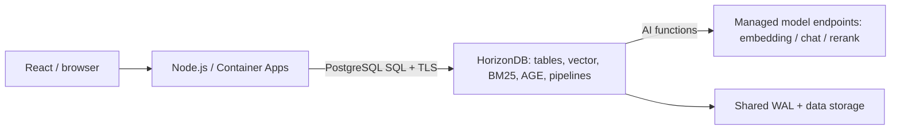

# Separate briefing: technology during deployment

[Contents](../../README.en.md) | [日本語](../ja/architecture.md)

A 15-minute instructor briefing after provisioning starts, before participants execute SQL. The instructor may substitute their own slides.

## Minutes 0–4: PostgreSQL on a cloud-native foundation

HorizonDB is a managed PostgreSQL-based database using existing PostgreSQL protocols and drivers. Compute and storage are separated; nodes share storage rather than maintaining one full data copy per reader.

**Database-as-a-log:** writer compute sends WAL to durable storage; storage reconstructs page state. This reduces traditional compute-side checkpoint write pressure while preserving ACID and separating compute scaling from storage growth.

## Minutes 4–7: Endpoints and availability

Use the writer's read/write endpoint for writes, DDL and pipeline operations. Reader endpoints distribute read traffic. This lab disables compute HA for minimum cost; production requires deliberate multi-node, zone and recovery planning. Zone-resilient storage and compute HA are distinct.

Parameter groups control extension allow lists and shared library loading. Allowing an extension and running `CREATE EXTENSION` in each database are separate steps. Static parameters require a restart.

## Minutes 7–12: Consolidate AI through SQL

| Goal | HorizonDB feature |
| --- | --- |
| Semantic retrieval | `ai.embed`, pgvector, DiskANN |
| Keywords and semantics | BM25 (`pg_textsearch`), `ai.search`, RRF |
| More precise ordering | `ai.rank` / search reranking |
| Text and structured inference | `ai.generate`, `ai.extract`, `ai.is_true` |
| Resumable ingestion | AI pipelines built on `pg_durable` |
| Relationship traversal | Apache AGE / Cypher |

Embeddings retrieve candidates; rerankers compare candidates with the query more closely. RRF combines **rank positions**, not incompatible raw scores.

## Minutes 12–15: What Zava eliminates

Reduce synchronization across separate vector databases, search services and graph stores. Model inference still uses managed endpoints, and UI/API hosting uses Container Apps. ACR stores images, Key Vault stores database credentials, and Log Analytics stores logs.

Room photos here are static UI assets. Live operations are text-based design and retrieval of 18 fictional furniture products—not multimodal inference or a production performance benchmark.

After the briefing, check cluster/pool/model/parameter readiness and proceed to [psql](02-postgresql.md). [Sources](../references.md)
