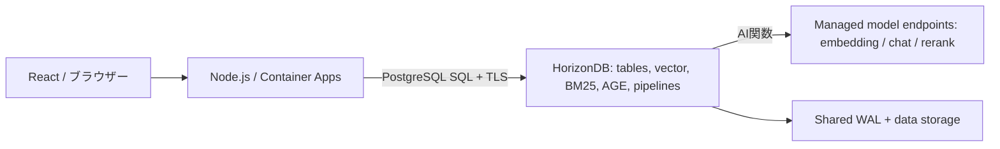

# 別資料: デプロイ待機中の技術解説

[目次](../../README.md) | [English](../en/architecture.md)

講師向けの約15分の説明資料です。クラスターの作成開始後に説明し、参加者はまだSQLを実行しません。必要に応じて講師自身のスライドに置き換えられます。

## 0–4分: PostgreSQLとクラウドネイティブな基盤

HorizonDBはPostgreSQLを基盤とするマネージドDBです。接続には既存のPostgreSQLプロトコルとドライバーを使います。一方、コンピュートとストレージは分離され、全ノードが共通のストレージを利用します。データコピーをreaderごとに増やす構成とは異なります。

**Database-as-a-log:** writerのコンピュートから永続層へはWALを送り、ストレージ側でページ状態を構築します。コンピュート側の従来型チェックポイントの書き込み負荷を減らす設計です。ACIDトランザクションを保ちつつ、コンピュートの拡張とストレージの成長を分けて扱えます。

## 4–7分: エンドポイントと可用性

write・DDL・パイプライン操作はwriterのread/write endpointで実行します。readerのread-only endpointは読み取り負荷の分散用です。今回の最小構成ではHAを無効にしますが、本番では複数ノード・ゾーン配置・復旧要件を設計します。ゾーン耐性のあるストレージと、コンピュートのHA設定は別の論点です。

パラメーターグループは拡張の許可リストと共有ライブラリの設定を管理します。許可リストに追加することと各DBで`CREATE EXTENSION`することは別の操作です。静的設定には再起動が必要です。

## 7–12分: AIスタックをSQLにまとめる

| やりたいこと | HorizonDBで使う機能 |
| --- | --- |
| 文章を意味で検索 | `ai.embed` + pgvector + DiskANN |
| 単語でも意味でも検索 | BM25 (`pg_textsearch`) + `ai.search` + RRF |
| 候補をさらに精密に並べる | `ai.rank` / searchのrerank |
| テキスト・構造化出力を生成 | `ai.generate`, `ai.extract`, `ai.is_true` |
| 取り込みを再試行・再開可能にする | `pg_durable`に基づくAI Pipeline |
| 関係を辿る | Apache AGE / Cypher |

Embeddingは検索候補を見つける表現、リランカーは候補と検索文を詳しく比較する再評価です。RRFは異なる検索の**順位**を統合するもので、異なるスコアをそのまま足し合わせるわけではありません。

## 12–15分: Zavaで何が減るか

専用ベクトルDB・検索サービス・グラフDBへのデータ同期を減らせます。ただしモデル推論は外部の管理されたモデルエンドポイント、画面とAPIはContainer Appsです。ACRにはイメージ、Key VaultにはDB接続の秘密情報、Log Analyticsにはログを保存します。「DBだけ」と言ってもホスティングやモデル実行が消えるわけではありません。

今回の写真は静的な画面素材です。実際に動くのはテキストの部屋提案と18件の家具検索です。性能・多言語品質・本番運用を検証するベンチマークではありません。

説明後、クラスター・pool・モデル・パラメーターの状態を確認し、[psql接続](02-postgresql.md)へ進みます。[出典](../references.md)
